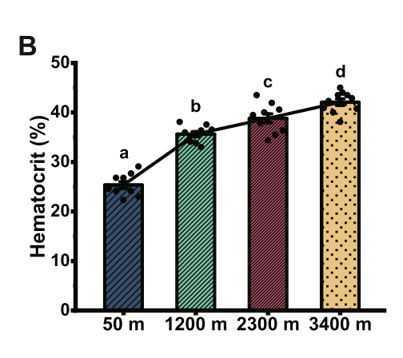

## 5.1 pch Symbols

The r-charts website has an explanation of how to generate Figure 1 using R. Their way code makes use of the expand.grid() function. Write a script that replicates this figure without using expand.grid(). Include the figure in your markdown document.

```{r}

#creating coordinates for the symbols in x and y axis
x <- rep(1:5, times = 6)
y <- rep(6:1, each = 5)

#plot the symbols and this is the same from the website. It showed me some warnings but since the graph shows up as I want, I ignored them
plot(x, y, pch = 0:30, cex = 2.5,
     yaxt = "n", xaxt = "n",
     ann = FALSE, xlim = c(0.5, 5.25),
     ylim = c(0.5, 6.5))

# creating coordinates for the numbers because each symbol has a number. In the original figure numbers are not in the same position as the symbols but to the left so I had to play around with the sequences.
x2 <- rep(seq(0.6, 4.6, 1), times = 6)
y2 <- rep(6:1, each = 5)

#this adds the numbers to the plot
text(x2[1:26], y2[1:26], 0:25)

```


## 5.2 Recreate a figure

The scientific literature is, of course, full of figures. Some are very good and beautiful, while others could have reperesented the exact same data in a much better way. Find a figure in a scientific paper of your choice that makes their data freely available.

If this is a figure that you like and find informative and easy to understand, try to recreate it as closely as possible in R.

If, on the contrary, you think this figure is not great, re-create an improved version.

In your answer include both the original and your recreated figure (and a citation of the original source), and an explanation of why you think this is a good/bad figure, and, if bad, how you improved it and why.

I selected a graph present in a paper (2024) called: Ecological adaptations of amphibians to environmental changes along an altitudinal gradient (Case Study: _Bufo gargarizans_) from phenotypic and genetic perspectives. 

Authors: Yonggang Niu, Xuejing Zhang, Haiying Zhang, Shengkang Men, Tisen Xu, Li Ding, Xiangyong Li, Lei Wang, Huisong Wang, Kenneth B. Storey & Qiang Chen 

This is the orgininal graph:


The figure is showing the change in levels of hematocrit percentage in toads across an altitudinal gradient. I think this graph could be improved. They didn't indicate that y-axis was the average of hematocrit percetange. 
The colors and textures inside the bars are not indicating anything else than the different altitudes, which for me it's not necessary because the x-axis has that information. Also, the bars are connected with lines although they are different populations of toads, and there are no relationship across individuals.

For this reason, I think I improved it by representing this data with a boxplot and the distribution of the points.

All data is in the folder, and I extracted the data of interest to re-do it. This figure belongs to a multipanel figure, but they are all the same style representing other variables of blood. Therefore, I decided to use only one example.

Here's the new graph, in my opinion, improved:

```{r}
data <- read.csv("RawData.csv", header = T)
head(data)
```
```{r}
boxplot(Hematocrit ~ Altitude, data = data,
        xlab = "Altitude (m.a.s.l.)",
        ylab = "Hematocrit (%)",
        col = "#F4B6C8",
        border = "#B34D73",
        lwd = 1.5)

stripchart(Hematocrit ~ Altitude, data = data,
           vertical = TRUE,
           method = "jitter",
           add = TRUE,
           pch = 16,
           col = rgb(0.7, 0.2, 0.4, alpha = 0.4),
           cex = 0.8)
```